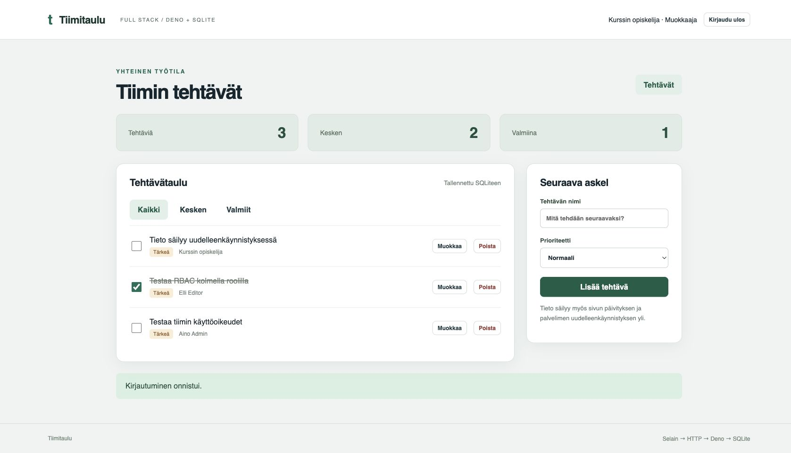

# Tiimitaulu: toimiva fullstack-sovellus alusta asti

Deno 2.9.6 / TypeScript, HTML, CSS, JavaScript ja SQLite (`node:sqlite`). Ei npm-riippuvuuksia eikä
frontendin käännösvaihetta. TypeScriptissä ei käytetä puolipisteitä.



## Käynnistä

Asenna Deno 2.2 tai uudempi ja avaa tämä hakemisto VS Codessa. Suositeltu laajennus on
`denoland.vscode-deno`. Editorin sulkuparit ja sisennys ovat käytössä. `deno.json` määrittää
puolipisteettömän muotoilun.

```sh
deno task migrate
deno task seed
deno task dev
```

Avaa `http://127.0.0.1:8000`. Paikallisen tutoriaalin demotunnukset ovat `admin@example.test`,
`editor@example.test` ja `viewer@example.test`. Niiden salasana on `OpetusDemo2026!`. Seed toimii
vain tyhjässä käyttäjätaulussa eikä nollaa olemassa olevia tietoja. Voit myös rekisteröidä uuden
katselijan tai luoda käyttäjän ylläpitäjän näkymässä.

Codespacesissa aseta selaimen esikatselun alkuperä ennen käynnistystä:

```sh
APP_ORIGIN=https://OMA-CODESPACE-8000.app.github.dev deno task dev
```

API tarkistaa Origin-otsakkeen. Codespacesissa huomioidaan myös välityspalvelimen tunnettu
uudelleenkirjoitus `https://localhost:8000`. HTTPS-alkuperä ottaa Secure-evästeen käyttöön.
APP_ORIGIN ei itsessään käynnistä HTTPS-palvelinta. Portin esikatselu saa pysyä yksityisenä.

Selain lähettää lisäksi `X-CSRF-Guard: 1` -otsakkeen. Arvo ei ole salaisuus tai käyttäjän tunnistus.
Sen lähettäminen vieraalta sivustolta vaatisi CORS-preflightin, jota tämä API ei hyväksy. Sama
tarkistus koskee myös kirjautumista ja uloskirjautumista. Istunto ja rooli tarkistetaan edelleen
palvelimella. Tämä on samaa alkuperää käyttävän JSON-API:n CSRF-malli, ei yleinen CORS-asetus.
Tausta:
[OWASP: custom request headers](https://cheatsheetseries.owasp.org/cheatsheets/Cross-Site_Request_Forgery_Prevention_Cheat_Sheet.html#employing-custom-request-headers-for-ajaxapi).

## Mitä rakennetaan

| Rooli                | Lue tehtävät | Luo, muokkaa ja poista tehtäviä | Hallitse käyttäjiä ja rooleja |
| -------------------- | ------------ | ------------------------------- | ----------------------------- |
| Katselija (`viewer`) | Kyllä        | Ei                              | Ei                            |
| Muokkaaja (`editor`) | Kyllä        | Kyllä                           | Ei                            |
| Ylläpitäjä (`admin`) | Kyllä        | Kyllä                           | Kyllä                         |

Tässä mallissa kaikki tehtävät kuuluvat yhteen yhteiseen tiimiin. Rooli määrää oikeudet yhteiseen
tauluun. Tämä ei ole usean organisaation eristetty järjestelmä.

Käyttäjähallinta sisältää rekisteröinnin, kirjautumisen, uloskirjautumisen sekä ylläpitäjän tekemän
käyttäjän luonnin, nimen muutoksen API:ssa, roolin vaihdon, sulkemisen, avaamisen ja poiston.
Viimeistä aktiivista ylläpitäjää ei voi poistaa, sulkea tai alentaa. Roolimuutos vaikuttaa jo
seuraavaan pyyntöön samalla istunnolla. Sulkeminen poistaa käyttäjän istunnot.

## Kirjoita ja selitä tässä järjestyksessä

1. `deno.json`, editorin asetukset ja `server/editor-demo.ts`: sulkupari syntyy editorissa, Enter
   luo lohkon sisään tilan ja IntelliSense täydentää `Deno.version`-nimen.
2. `migrations/001_initial.sql`, `server/db.ts` ja `scripts/migrate.ts`: luo tietokanta,
   parametroidut kyselyt ja migraatioiden kirjanpito. Aja `deno task migrate 1`.
3. `migrations/002_task_priority.sql` ja `scripts/migration-demo.ts`: lisää sarake ja näytä, että
   vanha tehtävä säilyy. Aja `deno task migration:demo` ja `deno task migrate`.
4. `server/security.ts`: salasana ja satunnainen istuntotunniste ovat eri asioita. Salasanalle
   käytetään PBKDF2-HMAC-SHA-256:ta, 600 000 kierrosta ja käyttäjäkohtaista suolaa. Satunnaisesta
   istuntotunnisteesta tallennetaan SHA-256-tiiviste.
5. `server/http.ts` ja `server/app.ts`: verkon JSON tarkistetaan ajon aikana. Istunto vastaa
   kysymykseen kuka, roolitarkistus kysymykseen saako. Puuttuva istunto saa 401:n, riittämätön rooli
   403:n. Toista tämä ero kirjautumisessa, tehtävissä ja käyttäjähallinnassa.
6. `server/main.ts`, `public/index.html`, `public/styles.css` ja `public/app.js`: selain lähettää
   pyynnön, palvelin tarkistaa oikeuden ja SQLite säilyttää tiedon. Näytä tämä sama matka tehtävän
   luonnissa, muutoksessa ja käyttäjän roolin vaihdossa.
7. Testit, demotunnukset ja käynnistys. Kokeile myös estettäviä toimintoja.
8. Pysäytä palvelin Ctrl+C:llä, käynnistä uudelleen ja päivitä selain. Tiedot säilyvät.

## Näytä todisteet

```sh
deno task check
deno task test
deno task migration:demo
```

Testit kattavat väärän salasanan, uniikin sähköpostin, roolin väärentämisen, SQL-syötteen, istunnon
vanhenemisen, uloskirjautumisen, kaikkien kolmen roolin sallitut ja estetyt toiminnot, roolin
muutoksen samalla istunnolla, tunnuksen sulkemisen ja avaamisen, viimeisen ylläpitäjän,
Origin-tarkistuksen, pyynnön kokorajan, yritysrajoituksen, migraation uudelleenajon, pysyvyyden,
transaktion perumisen ja käytetyn migraation muutoskiellon.

Käynnistä sovellus toiseen terminaaliin ja testaa myös oikean HTTP-yhteyden yli:

```sh
deno task test:live
# Codespaces: anna sama APP_ORIGIN-arvo testille argumentiksi.
deno task test:live https://OMA-CODESPACE-8000.app.github.dev
```

HTTP-testi luo omat testirivinsä ja siivoaa vain ne. Se näyttää oikeat 200-, 201-, 204-, 401- ja
403-vastaukset ja todistaa, ettei vanha istunto säilytä poistettua roolia. Evästeiden arvoja ei
tulosteta. Käynnissä oleva palvelin ja demoylläpitäjän tunnus tarvitaan.

HTTP-reitit: `POST /api/register`, `POST /api/login`, `POST /api/logout`, `GET /api/me`,
`GET/POST /api/tasks`, `PATCH/DELETE /api/tasks/:id`, `GET/POST /api/users` ja
`PATCH/DELETE /api/users/:id`. Kaikki muutospyynnöt tarvitsevat oikean Origin-otsakkeen;
JSON-runkoiset pyynnöt tarvitsevat `Content-Type: application/json`, ja muutospyynnöt myös
`X-CSRF-Guard: 1` -otsakkeen.

Tietokanta on `data/app.sqlite`. Migraatiodemo käyttää omaa erillistä tiedostoaan. Komentojen
tiedosto- ja verkkoluvat on rajattu tähän projektiin ja porttiin 8000.

Kurssimateriaali: https://r504tl209-deno-typescript-vitepress.onrender.com/

Projektin laajennussuositukset: Deno (`denoland.vscode-deno`) ja SQLite Viewer
(`qwtel.sqlite-viewer`). Editorin sulkuparit noudattavat kielen omia paritussaantoja
(`languageDefined`).
